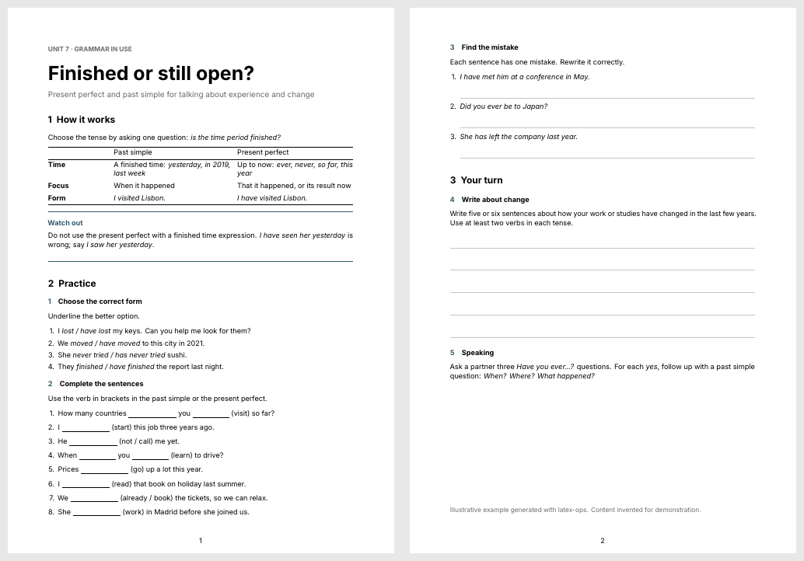

# latex-ops

**LaTeX documents that look published, not exported.** An agent skill for Claude Code, Codex and other [Agent Skills](https://agentskills.io) runtimes that turns notes, drafts and data into well-designed LaTeX, compiles it, and checks the PDF page by page before saying it is done. Works on Windows, macOS and Linux.



## Why

Agents already write LaTeX that compiles. The result usually looks like a default export: weak hierarchy, cramped tables, headings stranded at the bottom of a page, and a claim that "the PDF is ready" from an agent that never looked at it. latex-ops changes three things:

- **A design system, not a template folder.** Every document combines a *functional template* (what the reader does with it: workbook, proposal, paper, contract, lab report…) with a *visual preset* (how it looks: Swiss Minimal, Tufte Editorial, Modern Report…). 32 templates × 9 presets, each a compilable reference.
- **A closed loop.** Compile, read the log, render the pages, look, fix, rebuild. The agent never claims compilation, rendering or accessibility checks that did not happen.
- **Faithful content.** Nothing invented: missing prices, citations, scores or answer keys are marked `% [CONTENT: ...]`, and every number in a table or plot comes from the user's data or a stated formula.

## Examples

All four were produced with the skill and are in [`examples/`](examples/).

| Proposal with an undecided price | Research note with theorem, algorithm, plot and table |
| --- | --- |
|  |  |


## What it covers

| Area | Includes |
| --- | --- |
| Education | Workbook, Assessment Report, Course Plan, Book/Guide, Lecture Notes, Problem Set (with optional solutions) |
| Academic | Research Article, Conference Paper, Lab Report, Literature Review, Research Proposal, Statistical Report, Response to Reviewers, Classic and Technical Thesis, **ABNT academic work** (abnTeX2, for Brazilian TCC, dissertação and tese) |
| Professional | CV, Formal Letter, Executive Brief, Memo, Proposal, Invoice & Quote, Meeting Minutes |
| Legal and admin | Contract, Form |
| Editorial | Magazine, Brochure, Poster, Portfolio |
| Technical | Manual, SOP, One-Page Reference |
| Slides | Minimal Beamer |
| Rules | Typography and layout, classes and packages, accessibility (tagged PDF), academic papers and venue kits, Beamer, mathematics, statistics, Python/R/Julia/Quarto/Pandoc/Overleaf integration |
| Repair | Find the root file, fix the first real error with the smallest change, rebuild, report the evidence |

## Install

Copy `skills/latex-ops` into your agent's skills folder:

| Agent | Folder |
| --- | --- |
| Claude Code | `~/.claude/skills/latex-ops` (or `.claude/skills/` in a project) |
| Codex | `~/.agents/skills/latex-ops` |
| Other Agent Skills runtimes | their skills directory |

Or with the [`skills`](https://www.npmjs.com/package/skills) CLI:

```console
npx skills add https://github.com/pv-ca/latex-ops --skill latex-ops
```

Then just ask: *"turn these notes into a two-page worksheet"*, *"my thesis stopped compiling after I added fontspec"*, *"format this paper with the IEEE template"*.

## Requirements

- A TeX distribution with LuaLaTeX. **TeX Live** or **TinyTeX** recommended; **MiKTeX** works (install Perl for `latexmk`).
- Python 3.8+ for the helper scripts (standard library only).

The skill checks the machine on first use and tells you exactly what is missing:

```console
python skills/latex-ops/scripts/check_env.py            # report
python skills/latex-ops/scripts/check_env.py --install  # show the install command
```

| You have | The skill suggests |
| --- | --- |
| Nothing | TinyTeX (no administrator rights needed), then `tlmgr install` the listed packages |
| TeX Live or TinyTeX | `tlmgr install <missing packages>` |
| MiKTeX | `miktex packages install <missing packages>`, plus Perl for `latexmk` |
| TeX Live from apt, dnf, pacman or zypper | the matching system command (it never runs `sudo` itself) |

Installing anything always waits for your confirmation. The full list of packages the templates use is in [`assets/requirements.txt`](skills/latex-ops/assets/requirements.txt).

## Scripts

| Script | Does |
| --- | --- |
| `check_env.py` | Detects distribution, engines, latexmk, PDF renderer and missing packages |
| `build.py file.tex` | Compiles with latexmk (or the engine plus biber/bibtex), shell escape off, and prints errors with file and line, undefined references and citations, missing glyphs and overfull boxes |
| `preview.py file.pdf --pages 1-3` | Renders pages to PNG with pdftoppm, mutool or Ghostscript so the agent can look at them |

## Development

```console
python3 -m unittest discover -s tests       # script tests
python3 tests/build_templates.py            # compile every template and example
```

CI compiles every template and example on Linux and Windows with only the packages in `requirements.txt`.

## License

[MIT](LICENSE)
