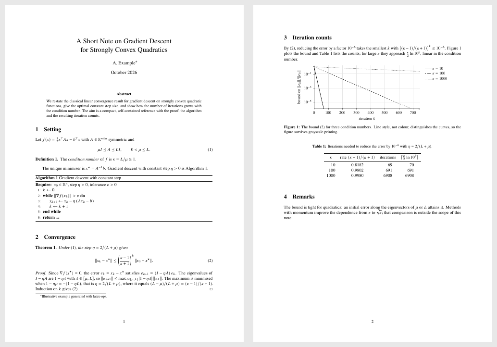
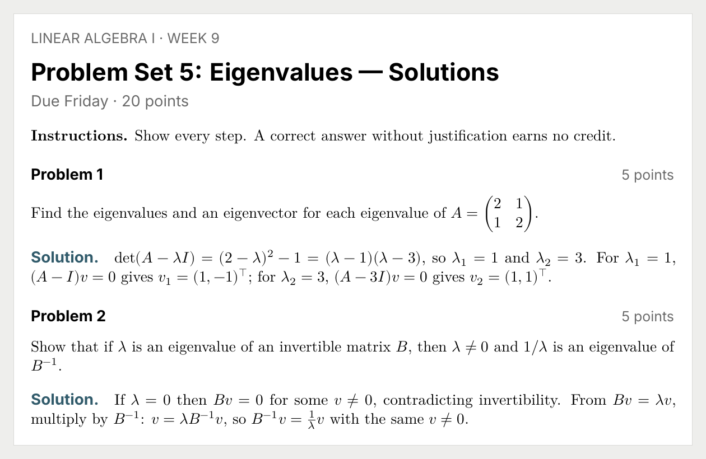
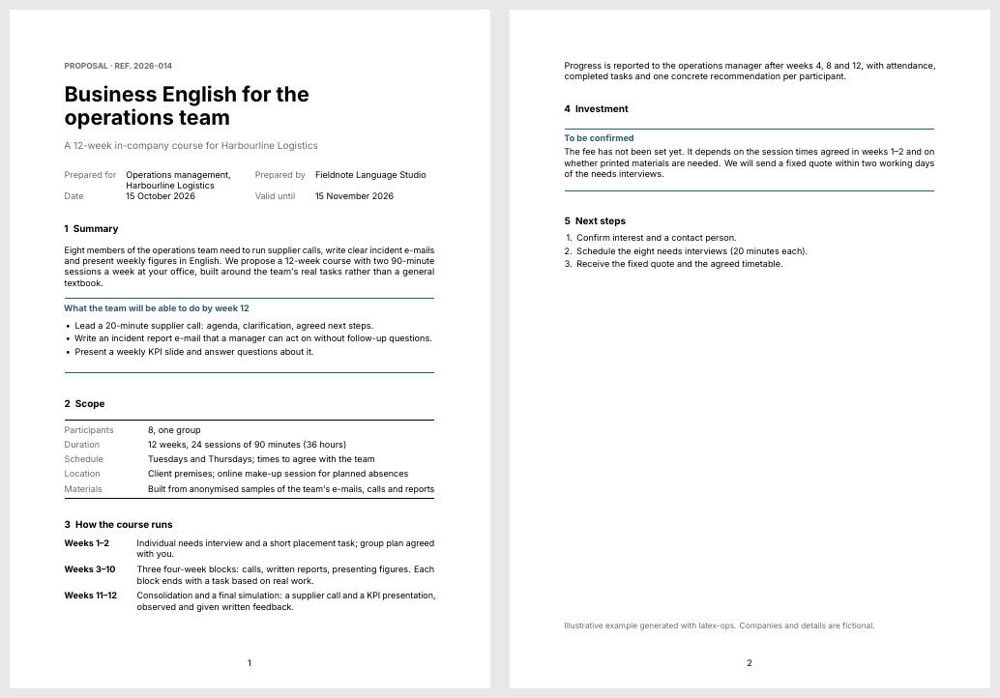
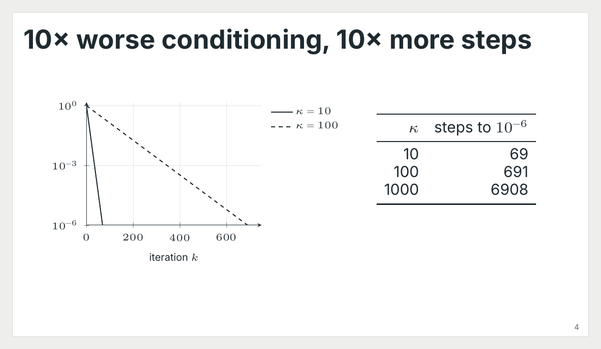

<div align="center">

**English** · [Português (Brasil)](docs/readme/README_pt-BR.md)

# latex-ops

### Academic LaTeX, compiled and checked.

[](https://agentskills.io)
[](#install)
[](#install)
[](https://github.com/pv-ca/latex-ops/actions/workflows/ci.yml)

[](#what-is-inside)
[](LICENSE)

[Install](#install) · [What it does](#what-it-does) · [Examples](#examples) · [What is inside](#what-is-inside) · [Requirements](#requirements) · [Evaluation](#evaluation) · [FAQ](#faq)

<code>npx skills add https://github.com/pv-ca/latex-ops --skill latex-ops</code>

<br><br>



</div>

---

You ask your agent for a paper, a thesis chapter, lecture notes or a problem set. It writes LaTeX that compiles, says the PDF is ready, and you open it to find a table running off the page, a heading stranded at the bottom, a plot whose legend covers the data, or a citation it made up.

**latex-ops** is an [Agent Skill](https://agentskills.io) that changes how the agent works on LaTeX. It chooses a document structure and a visual style that fit the reader, writes the source with the mathematics and statistics done properly, compiles it, renders the pages and looks at them, fixes what it sees, and tells you exactly what it checked. It never invents a citation, a number or a requirement it was not given.

It is built for academic work first (articles, conference papers, theses, ABNT work in Brazil, proposals, reports, lecture notes, problem sets, posters and talks) and also covers the professional documents in its template set. It runs wherever Agent Skills run, on Windows, macOS and Linux.

## Install

Choose one installation method for each agent. Installing both the plugin and a standalone copy can load the skill twice. These commands install the skill and its helper scripts; TeX and Python are separate prerequisites.

<details>
<summary><strong>Claude Code: plugin</strong></summary>

```bash
claude plugin marketplace add pv-ca/latex-ops
claude plugin install latex-ops@pvca-latex
```

The repository provides its own marketplace. It does not need to be listed in the official plugin directory.

</details>

<details>
<summary><strong>Codex: plugin</strong></summary>

```bash
codex plugin marketplace add pv-ca/latex-ops
codex plugin add latex-ops@pvca-latex
```

Requires a Codex version with the `plugin` commands. The package includes a Codex manifest pointing to the same skill used by Claude Code.

</details>

<details open>
<summary><strong>Other agents, or standalone skills</strong></summary>

With Node.js and npm available, run:

```bash
npx skills add pv-ca/latex-ops --skill latex-ops
```

The [skills CLI](https://github.com/vercel-labs/skills) lets you choose the agent and installation scope. You can select an agent explicitly:

```bash
npx skills add pv-ca/latex-ops --skill latex-ops --agent codex
npx skills add pv-ca/latex-ops --skill latex-ops --agent claude-code
```

</details>

<details>
<summary><strong>Manual copy</strong></summary>

```bash
git clone https://github.com/pv-ca/latex-ops
cp -r latex-ops/skills/latex-ops ~/.claude/skills/      # Claude Code
cp -r latex-ops/skills/latex-ops ~/.agents/skills/      # Codex
```

On Windows, copy `skills\latex-ops` into `%USERPROFILE%\.claude\skills\` or `%USERPROFILE%\.agents\skills\`. Keep the scripts, references and assets together with `SKILL.md`.

</details>

Start a new agent session after installation. If you already maintain a shared skill tree, use its installer and avoid adding a second copy.

### First use

Ask your agent:

> Use latex-ops to check my LaTeX environment. Report missing dependencies before installing anything. Then compile the attached document, inspect the PDF and tell me what you checked.

Give it your source files, data, images and any mandatory author kit. For a new document, describe the intended reader and output: paper, thesis, problem set or slides. The agent checks the environment, chooses a template and preset when appropriate, and returns LaTeX source, a PDF if compilation succeeds, and a verification report. A venue or university template controls the format.

### Updates

For a CLI installation, use `npx skills update latex-ops`. For a manual copy, pull this repository and replace the copied skill folder after preserving local edits. For plugins, use your agent's plugin update controls; update timing depends on the host and its settings. Check [releases](https://github.com/pv-ca/latex-ops/releases) for changes.

## What it does

```text
your request ─▶ choose template + preset ─▶ write the source ─▶ compile (build.py)
                                                                      │
          report what was checked ◀── fix and rebuild ◀── render and look (preview.py)
```

- **Two coordinates for every document.** A *functional template* decides what the document must do (a conference paper, a problem set, a response to reviewers) and a *visual preset* decides how it looks (Minimal Research, Tufte Editorial, Kao Textbook…). The venue's official kit always wins over both.
- **A closed loop.** The agent compiles, reads the log, renders the pages, and looks for the defects a compiler does not report: overflowing tables, stranded headings, nearly empty pages, legends over data, missing glyphs.
- **Nothing invented.** Missing facts are marked `% [CONTENT: ...]` where they belong. Citations must be checked sources. Numbers in tables and plots come from your data or a stated formula. Claims of "compiled", "checked" or "accessible" are made only when that check ran.
- **Mathematics and statistics done properly.** Display environments, aligned derivations, theorem systems, declared operators, `siunitx`, `pgfplots` from CSV, regression tables generated by your analysis code, results reported with effect sizes and intervals.
- **Repairs without collateral damage.** For a broken build it finds the root file, fixes the first real error with the smallest change, never edits official class files, and shows the diff.

## Examples

Each was produced with the skill, compiled and checked page by page. Sources are in [`examples/`](examples/).

| Problem set with solutions from the same source | Research proposal with an undecided budget |
| --- | --- |
|  |  |



Things you can ask:

```text
Format this paper with the IEEE conference template and tell me which requirements it still fails.
```
```text
Write lecture notes on the Cauchy–Schwarz inequality with a full proof, two examples and three exercises.
```
```text
Here is results.csv. Make a two-page statistical report with a regression table and a scatter plot.
```
```text
Monte a estrutura do meu TCC nas normas ABNT com capa, folha de rosto, resumo e abstract.
```
```text
My thesis stopped compiling after I added fontspec. Fix it without touching anything else.
```

## What is inside

| Area | Templates |
| --- | --- |
| Research | Research Article · Conference Paper (review and camera-ready) · Literature Review · Research Proposal · Response to Reviewers · Scientific Poster |
| Theses | Classic Thesis · Technical Thesis · **ABNT academic work** with abnTeX2 (TCC, monografia, dissertação, tese) |
| Data and lab | Statistical Report (pgfplots from CSV) · Lab Report (units and uncertainty) |
| Teaching | Lecture Notes (theorem system) · Problem Set (solutions switch) · Course Plan · Assessment Report · Book / Guide |
| Professional | CV · Formal Letter · Executive Brief · Memo · Proposal · Invoice & Quote · Contract · Meeting Minutes · Technical Manual · SOP · One-Page Reference · Form · Magazine · Brochure · Portfolio |
| Visual presets | Minimal Research · Classic Editorial · Tufte Editorial · Kao Textbook · Swiss Minimal · Modern Report · Legal Minimal · Magazine Editorial · Minimal Beamer |

32 functional template files and 9 presets, each a compilable `.tex` reference the agent can adapt to your document.

| Reference the agent reads when needed | Covers |
| --- | --- |
| [`design-rules.md`](skills/latex-ops/references/design-rules.md) | Typography, classes and packages, components, accessibility, academic papers and venue kits, Beamer |
| [`math.md`](skills/latex-ops/references/math.md) | Fonts and engines, display environments, alignment, notation, theorems, matrices, units, algorithms, plots, checking the mathematics, common errors |
| [`statistics.md`](skills/latex-ops/references/statistics.md) | Where numbers come from, reporting tests and models, decimal-aligned tables, regression tables, statistical plots |
| [`integrations.md`](skills/latex-ops/references/integrations.md) | Python, R, Julia, Quarto, Pandoc, TikZ systems, Overleaf |
| [`platforms.md`](skills/latex-ops/references/platforms.md) | TeX Live, TinyTeX, MiKTeX, Linux packages, Windows specifics, fonts |

| Script (Python 3.8+, standard library only) | Does |
| --- | --- |
| `check_env.py` | Detects the distribution, engines, latexmk, PDF renderer and missing packages; `--install` shows the install command, `--install --yes` runs it after you agree |
| `build.py file.tex` | Compiles with latexmk, or the engine plus biber/bibtex until references settle; shell escape off; prints errors with file and line, undefined references, missing glyphs, overfull boxes |
| `preview.py file.pdf --pages 1-3` | Renders pages to PNG with pdftoppm, mutool or Ghostscript so the agent can look at them |

## Requirements

- A TeX distribution with LuaLaTeX: **TeX Live** or **TinyTeX** recommended; **MiKTeX** works.
- Python 3.8 or newer for the helper scripts.

The skill runs `check_env.py` the first time and when a build fails for reasons outside the document, and tells you what to do:

| You have | It suggests |
| --- | --- |
| No TeX at all | [TinyTeX](https://yihui.org/tinytex) (per-user, no administrator rights), then `tlmgr install` the listed packages |
| TeX Live or TinyTeX | `tlmgr install <missing packages>` |
| MiKTeX | `miktex packages install <missing packages>`, plus Strawberry Perl for latexmk |
| TeX Live from apt, dnf, pacman or zypper | The matching system command (it never runs `sudo` itself) |

Nothing is installed without your confirmation. The full package list is [`assets/requirements.txt`](skills/latex-ops/assets/requirements.txt); CI installs exactly that list on Linux and Windows and compiles every template and example.

## Evaluation

Four requests were run once by an agent with the skill and once without it, and graded on 33 checkable criteria: fixing a `fontspec` build broken by the wrong engine, a MiKTeX font error on Windows, lecture notes with a proof, and an ABNT thesis skeleton.

| | With latex-ops | Without |
| --- | --- | --- |
| Criteria met | 33 / 33 | 30 / 33 |
| Mean time per task | 77 s | 50 s |
| Mean tokens per task | 64 k | 49 k |

The base model is already good at LaTeX: both versions compiled all three document outputs and invented nothing. The difference was the verification loop. Without the skill, the agent did not look at the rendered pages in any of the three tasks that produced a document, so layout problems would have reached the user unseen. The skill costs about half a minute and 15 k tokens more per task. One run per configuration, so treat this as a first signal with limited evidence; the prompts are in [`evals/evals.json`](skills/latex-ops/evals/evals.json).

## FAQ

<details>
<summary><strong>Which agents does it work in?</strong></summary>

Any runtime that loads Agent Skills (a folder with a `SKILL.md`): Claude Code, Codex, and the agents the `skills` CLI supports. The scripts are plain Python, so they run the same way in each.
</details>

<details>
<summary><strong>Will it use my journal's or university's template?</strong></summary>

Yes, and that template wins. The skill asks for (or downloads from the official page) the author kit for the venue, year and stage, migrates the content into it, and reports each requirement as pass, fail or unverified. It never rewrites a class file from memory and never shrinks fonts or margins to meet a page limit.
</details>

<details>
<summary><strong>Does it write the paper for me?</strong></summary>

It writes and structures what you give it, and it can draft text you ask for, but it does not invent results, data, citations or claims. Where something is missing it leaves a visible `[CONTENT: ...]` marker so nothing fabricated slips into a submission.
</details>

<details>
<summary><strong>Does it work on Overleaf?</strong></summary>

The agent works on files on your computer. It can prepare a self-contained project to upload to Overleaf, or work on one you downloaded, respecting the compiler set in the Overleaf menu.
</details>

<details>
<summary><strong>Does it support languages other than English?</strong></summary>

Yes. Documents use `babel` for their language and hyphenation; the ABNT template is in Portuguese. The agent replies in your language.
</details>

<details>
<summary><strong>Does it run code from my documents?</strong></summary>

Not by default: builds run with shell escape off. Features that need it (`minted`, PythonTeX, TikZ externalisation) are enabled only when you ask, and the agent tells you that the document will run programs.
</details>

## Compatibility and verification

| Environment | What is checked |
| --- | --- |
| Linux + TeX Live | CI compiles all 45 documents (32 functional templates, 9 presets and 4 examples) and renders page 1 of each |
| Windows + TeX Live | The same compile-and-render suite runs in CI |
| macOS | The Python scripts and TeX workflow are designed for it; there is no macOS CI job |
| MiKTeX | Environment detection and installation guidance are included; CI uses TeX Live |
| Plugin packaging | Plugin metadata and skill paths have structural tests; the Claude plugin and marketplace manifests pass native strict validation |

A passing build checks compilation and preview generation. Page layout still needs visual inspection. The agent reports that inspection separately. The plugin installation flows have not been exercised end to end on fresh agent profiles.

## Troubleshooting

| Symptom | Next step |
| --- | --- |
| The agent cannot find the skill | Open a new session and check the selected agent and installation scope |
| `fontspec` fails under pdfLaTeX | Use LuaLaTeX or XeLaTeX, unless the required class needs a different font setup |
| A font or package is missing | Run `check_env.py`; review the proposed command before installation |
| A PDF exists but the build failed | Read the driver output too: latexmk can fail during indexing or bibliography processing after TeX writes a PDF |
| The PDF cannot be rendered | Install a supported renderer separately, or inspect the PDF directly and report that limitation |

## Repository layout

```text
skills/latex-ops/
  SKILL.md           Request routing and the compile/inspect workflow
  references/        Design, mathematics, statistics and platform details
  scripts/           Environment check, build and preview helpers
  assets/            Templates and declared TeX dependencies
  evals/             Published evaluation prompts
examples/            Complete sample documents
tests/              Script, packaging and compile/render checks
```

The plugin manifests point to `skills/latex-ops`. The instructions have one source across installation methods.

## Development

```bash
python3 -m unittest discover -s tests       # script tests
python3 tests/build_templates.py            # compile every template and example
```

Issues and pull requests are welcome. A new template should compile with only the packages in `requirements.txt` (add any it needs) and come with an entry in `references/functional-templates.md`.

## License

[MIT](LICENSE)
