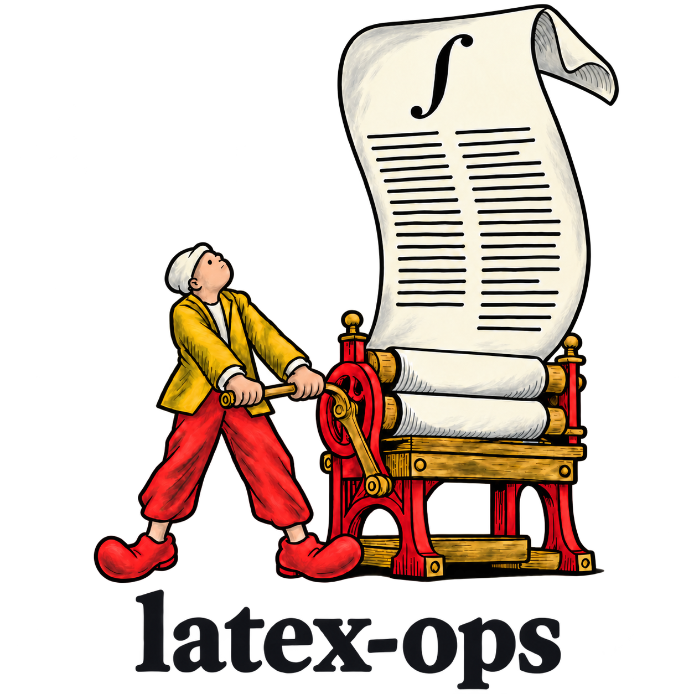

<div align="center">

<picture>
  <source media="(prefers-color-scheme: dark)" srcset="../branding/latex-ops-surreal-textured-natural-dark.png">
  <source media="(prefers-color-scheme: light)" srcset="../branding/latex-ops-surreal-textured-natural-light.png">
  
</picture>

### Seu agente para LaTeX acadêmico.

[](https://github.com/pv-ca/latex-ops/actions/workflows/ci.yml)
[](../../LICENSE)

[English](../../README.md) · **Português (Brasil)**

[Instalação](#instalação) · [O que faz](#o-que-faz) · [Exemplos](#exemplos) · [O que vem incluído](#o-que-vem-incluído) · [Requisitos](#requisitos) · [Avaliação](#avaliação) · [Perguntas frequentes](#perguntas-frequentes)

<code>npx skills add https://github.com/pv-ca/latex-ops --skill latex-ops</code>

<br><br>


</div>

---

Você pede ao seu agente um artigo, um capítulo de tese, notas de aula ou uma lista de exercícios. Ele escreve um LaTeX que compila, diz que o PDF está pronto, e ao abrir você encontra uma tabela saindo da página, um título sozinho no pé da página, um gráfico com a legenda em cima dos dados ou uma citação inventada.

O **latex-ops** é seu agente para LaTeX acadêmico. Ele funciona como uma [Agent Skill](https://agentskills.io) no Claude Code, no Codex e em outras ferramentas compatíveis. Ele escolhe uma estrutura de documento e um estilo visual adequados ao leitor, escreve o código com a matemática e a estatística feitas do jeito certo, compila, renderiza e inspeciona páginas com cobertura declarada, corrige o que encontra e diz exatamente o que conferiu. Ele nunca inventa uma citação, um número ou uma exigência que não recebeu.

O foco é o trabalho acadêmico (artigos, artigos de conferência, teses, trabalhos na ABNT, propostas, relatórios, notas de aula, listas de exercícios, pôsteres e apresentações), e ele também cobre os documentos profissionais do seu conjunto de templates. Funciona onde as Agent Skills funcionam, no Windows, no macOS e no Linux.

## Instalação

Escolha um método por agente. Instalar o plugin e uma cópia avulsa pode carregar a skill duas vezes. Os comandos abaixo instalam a skill e seus scripts; TeX e Python são requisitos separados.

<details>
<summary><strong>Claude Code: plugin</strong></summary>

```bash
claude plugin marketplace add pv-ca/latex-ops
claude plugin install latex-ops@pvca-latex
```

O repositório fornece seu próprio marketplace. Ele pode ser usado sem constar no diretório oficial de plugins.

</details>

<details>
<summary><strong>Codex: plugin</strong></summary>

```bash
codex plugin marketplace add pv-ca/latex-ops
codex plugin add latex-ops@pvca-latex
```

Requer uma versão do Codex com os comandos `plugin`. O manifesto do Codex aponta para a mesma skill usada pelo Claude Code.

</details>

<details open>
<summary><strong>Outros agentes ou skill avulsa</strong></summary>

Com Node.js e npm disponíveis, execute:

```bash
npx skills add pv-ca/latex-ops --skill latex-ops
```

A [CLI skills](https://github.com/vercel-labs/skills) permite escolher o agente e o escopo da instalação. Você também pode indicar o agente:

```bash
npx skills add pv-ca/latex-ops --skill latex-ops --agent codex
npx skills add pv-ca/latex-ops --skill latex-ops --agent claude-code
```

</details>

<details>
<summary><strong>Cópia manual</strong></summary>

```bash
git clone https://github.com/pv-ca/latex-ops
cp -r latex-ops/skills/latex-ops ~/.claude/skills/      # Claude Code
cp -r latex-ops/skills/latex-ops ~/.agents/skills/      # Codex
```

No Windows, copie `skills\latex-ops` para `%USERPROFILE%\.claude\skills\` ou `%USERPROFILE%\.agents\skills\`. Mantenha scripts, referências e assets junto do `SKILL.md`.

</details>

Abra uma sessão nova depois da instalação. Se você já mantém uma árvore compartilhada de skills, use o instalador dela para evitar uma segunda cópia.

### Primeiro uso

Peça ao agente:

> Use latex-ops para conferir meu ambiente LaTeX. Informe o que falta antes de instalar qualquer coisa. Depois compile o documento anexado, examine o PDF e diga o que conferiu.

Forneça os fontes, dados, imagens e o kit oficial de autor quando houver. Para um documento novo, diga quem vai ler e qual é a entrega: artigo, tese, lista de exercícios ou slides. O agente confere o ambiente, escolhe template e preset quando cabe, e entrega o fonte LaTeX, o PDF se a compilação funcionar e um relato da verificação. O template da revista ou da universidade determina a formatação.

### Atualizações

Na instalação pela CLI, use `npx skills update latex-ops`. Na cópia manual, atualize este repositório e substitua a pasta copiada depois de preservar suas alterações locais. Para plugins, use os controles de atualização do agente; a frequência depende do programa e das configurações dele. As mudanças constam nas [releases](https://github.com/pv-ca/latex-ops/releases).

## O que faz

```text
seu pedido ─▶ escolhe template + preset ─▶ escreve o código ─▶ compila (build.py)
                                                                     │
       relata o que conferiu ◀── corrige e recompila ◀── renderiza e olha (preview.py)
```

- **Duas coordenadas para cada documento.** Um *template funcional* define o que o documento precisa fazer (um artigo de conferência, uma lista de exercícios, uma resposta aos revisores) e um *preset visual* define a aparência (Minimal Research, Tufte Editorial, Kao Textbook…). O kit oficial da revista ou da universidade sempre prevalece sobre os dois.
- **Ciclo fechado.** O agente compila, lê o log, renderiza as páginas e procura os defeitos que o compilador não aponta: tabelas estourando a margem, títulos isolados, páginas quase vazias, legendas sobre os dados, caracteres faltando.
- **Nada inventado.** O que falta recebe marcadores visíveis `[CONTENT: ...]` no rascunho e uma lista de pendências. Comentários no fonte são notas de trabalho e não aparecem no PDF. Citações precisam ser de fontes conferidas. Números de tabelas e gráficos vêm dos seus dados ou de uma fórmula declarada. "Compilou", "conferi" e "acessível" só são ditos quando a verificação aconteceu de fato.
- **Matemática e estatística bem feitas.** Ambientes de equação, deduções alinhadas, sistema de teoremas, operadores declarados, `siunitx`, `pgfplots` lendo CSV, tabelas de regressão geradas pelo seu código de análise, resultados com tamanho de efeito e intervalo de confiança.
- **Consertos sem efeito colateral.** Num build quebrado, ele encontra o arquivo principal, corrige o primeiro erro real com a menor mudança possível, nunca edita arquivos de classe oficiais e mostra o diff.

## Exemplos

Estes exemplos foram feitos com a skill. O CI os recompila e renderiza a primeira página de cada um; essa verificação automática não inspeciona o layout. Os fontes estão em [`examples/`](../../examples/).

| Lista de exercícios com gabarito no mesmo arquivo | Proposta de pesquisa com orçamento ainda não definido |
| --- | --- |
|  |  |


Pedidos que você pode fazer:

```text
Monte a estrutura do meu TCC nas normas ABNT com capa, folha de rosto, resumo e abstract.
```
```text
Formate este artigo no template de conferência do IEEE e me diga quais requisitos ainda não atende.
```
```text
Escreva notas de aula sobre a desigualdade de Cauchy–Schwarz com a prova completa, dois exemplos e três exercícios.
```
```text
Aqui está o resultados.csv. Faça um relatório estatístico de duas páginas com tabela de regressão e gráfico de dispersão.
```
```text
Minha tese parou de compilar depois que coloquei o fontspec. Conserta sem mexer no resto.
```

## O que vem incluído

| Área | Templates |
| --- | --- |
| Pesquisa | Artigo de pesquisa · Artigo de conferência (revisão e versão final) · Revisão de literatura · Proposta de pesquisa · Resposta aos revisores · Pôster científico |
| Teses | Tese clássica · Tese técnica · **Trabalho acadêmico ABNT** com abnTeX2 (TCC, monografia, dissertação, tese) |
| Dados e laboratório | Relatório estatístico (pgfplots a partir de CSV) · Relatório de laboratório (unidades e incerteza) |
| Ensino | Notas de aula (sistema de teoremas) · Lista de exercícios (chave de gabarito) · Plano de curso · Relatório de avaliação · Livro / guia |
| Profissional | Currículo · Carta formal · Resumo executivo · Memorando · Proposta · Fatura e orçamento · Contrato · Ata de reunião · Manual técnico · POP · Referência de uma página · Formulário · Revista · Folheto · Portfólio |
| Presets visuais | Minimal Research · Classic Editorial · Tufte Editorial · Kao Textbook · Swiss Minimal · Modern Report · Legal Minimal · Magazine Editorial · Minimal Beamer |

São 32 arquivos de templates funcionais e 9 presets, cada um um `.tex` que compila e serve de referência para o seu documento.

| Referência que o agente lê quando precisa | Cobre |
| --- | --- |
| [`design-rules.md`](../../skills/latex-ops/references/design-rules.md) | Tipografia, classes e pacotes, componentes, acessibilidade, artigos acadêmicos e kits de revistas, Beamer |
| [`math.md`](../../skills/latex-ops/references/math.md) | Fontes e motores, ambientes de equação, alinhamento, notação, teoremas, matrizes, unidades, algoritmos, gráficos, conferência das contas, erros comuns |
| [`statistics.md`](../../skills/latex-ops/references/statistics.md) | De onde vêm os números, relato de testes e modelos, tabelas alinhadas na vírgula decimal, tabelas de regressão, gráficos estatísticos |
| [`integrations.md`](../../skills/latex-ops/references/integrations.md) | Python, R, Julia, Quarto, Pandoc, sistemas de diagramas TikZ, Overleaf |
| [`platforms.md`](../../skills/latex-ops/references/platforms.md) | TeX Live, TinyTeX, MiKTeX, pacotes do Linux, particularidades do Windows, fontes |

| Script (Python 3.8+, só biblioteca padrão) | Faz |
| --- | --- |
| `check_env.py` | Detecta a distribuição, os motores, o latexmk, o renderizador de PDF e os pacotes que faltam; `--install` mostra o comando de instalação e `--install --yes` executa depois que você concorda |
| `build.py arquivo.tex` | Compila com latexmk, ou com o motor mais Biber/BibTeX e makeindex quando necessários; falhas de backend e builds não estabilizados reprovam; shell escape e carregamento de rc desligados por padrão; mostra erros com arquivo e linha, referências indefinidas, caracteres faltando e caixas estouradas |
| `preview.py arquivo.pdf --pages 1-3` | Converte páginas novas em PNG com pdftoppm, mutool ou Ghostscript; `--timeout 60` limita cada página; o agente as inspeciona separadamente |

## Requisitos

- Uma distribuição TeX com LuaLaTeX: **TeX Live** ou **TinyTeX** recomendados; **MiKTeX** funciona.
- Python 3.8 ou mais novo para os scripts.

A skill roda o `check_env.py` na primeira vez e quando um build falha por motivo externo ao documento, e diz o que fazer:

| Você tem | Ela sugere |
| --- | --- |
| Nenhum TeX | [TinyTeX](https://yihui.org/tinytex) (por usuário, sem precisar de administrador) e depois `tlmgr install` dos pacotes listados |
| TeX Live ou TinyTeX | `tlmgr install <pacotes que faltam>` |
| MiKTeX | `miktex packages install <pacotes que faltam>`, mais o Strawberry Perl para o latexmk |
| TeX Live do apt, dnf, pacman ou zypper | O comando do sistema correspondente (ela nunca roda `sudo` por conta própria) |

Nada é instalado sem a sua confirmação. A lista completa de pacotes está em [`assets/requirements.txt`](../../skills/latex-ops/assets/requirements.txt); o CI instala exatamente essa lista no Linux e no Windows e compila todos os templates e exemplos.

## Avaliação

**Avaliação histórica da v0.1.0; não foi refeita para a v0.1.2.** Quatro pedidos foram executados uma vez por um agente com a skill e uma vez sem ela, e avaliados em 33 critérios verificáveis: consertar um build com `fontspec` quebrado pelo motor errado, um erro de fonte do MiKTeX no Windows, notas de aula com uma prova e a estrutura de um TCC na ABNT.

| | Com latex-ops | Sem |
| --- | --- | --- |
| Critérios atendidos | 33 / 33 | 30 / 33 |
| Tempo médio por tarefa | 77 s | 50 s |
| Tokens médios por tarefa | 64 mil | 49 mil |

O modelo base já é bom em LaTeX: as duas versões compilaram os três documentos produzidos e não inventaram nada. A diferença foi o ciclo de verificação. Sem a skill, o agente não olhou as páginas renderizadas em nenhuma das três tarefas que produziram documento, então problemas de layout chegariam ao usuário sem ninguém ver. A skill custa cerca de meio minuto e 15 mil tokens a mais por tarefa. Foi uma rodada por configuração, então trate como um primeiro sinal, com evidência limitada; os pedidos estão em [`evals/evals.json`](../../skills/latex-ops/evals/evals.json).

## Perguntas frequentes

<details>
<summary><strong>Em quais agentes funciona?</strong></summary>

Em qualquer ambiente que carregue Agent Skills (uma pasta com um `SKILL.md`): Claude Code, Codex e os agentes suportados pela CLI `skills`. Os scripts são Python puro e rodam do mesmo jeito em todos.
</details>

<details>
<summary><strong>Ela usa o template da minha revista ou universidade?</strong></summary>

Sim, e esse template prevalece. A skill pede (ou baixa da página oficial) o kit de autor da revista, do ano e da fase, migra o conteúdo para ele e relata cada requisito como atendido, não atendido ou não verificado. Ela nunca reescreve um arquivo de classe de memória e nunca reduz fonte ou margem para caber no limite de páginas.
</details>

<details>
<summary><strong>Ela escreve o trabalho por mim?</strong></summary>

Ela escreve e estrutura o que você fornece e pode redigir o texto que você pedir, mas não inventa resultados, dados, citações nem afirmações. O que falta permanece em marcadores visíveis `[CONTENT: ...]` no rascunho e na lista de pendências da entrega. Rascunhos são entregas válidas, identificadas como tal; marcadores pendentes impedem declarar o documento pronto para submissão.
</details>

<details>
<summary><strong>Funciona com o Overleaf?</strong></summary>

O agente trabalha com arquivos no seu computador. Ele pode preparar um projeto completo para subir no Overleaf ou trabalhar num projeto que você baixou de lá, respeitando o compilador escolhido no menu do Overleaf.
</details>

<details>
<summary><strong>Funciona em português e outras línguas?</strong></summary>

Sim. Os documentos usam o `babel` para a língua e a hifenização; o template ABNT é em português. O agente responde na sua língua.
</details>

<details>
<summary><strong>Ela executa código dos meus documentos?</strong></summary>

O TeX interpreta o documento durante a compilação. O utilitário desativa shell escape e carregamento de rc do latexmk por padrão. `--shell-escape` permite programas externos pelo TeX; `--trust-project-config` permite, separadamente, carregar arquivos rc, que executam Perl mesmo com shell escape desligado. Use essas opções apenas para código revisado e coberto pela autorização da tarefa. Nenhuma delas oferece isolamento.
</details>

## Compatibilidade e verificação

| Ambiente | O que é verificado |
| --- | --- |
| Linux + TeX Live | O CI compila os 45 documentos (32 templates funcionais, 9 presets e 4 exemplos) e renderiza a primeira página de cada um |
| Windows + TeX Live | A mesma bateria de compilação e renderização roda no CI |
| Bibliografia e índice | Testes com TeX real nas duas plataformas cobrem BibTeX, Biber, índice no fallback, saída separada, caminhos com pontos/espaços e a opção de confiança para rc |
| macOS | Os scripts Python e o fluxo TeX foram escritos para funcionar nele; não há job de CI para macOS |
| MiKTeX | Há detecção do ambiente e orientação de instalação; o CI usa TeX Live |
| Empacotamento do plugin | Os metadados e caminhos das skills têm testes estruturais; os manifestos de plugin e marketplace do Claude passam na validação nativa estrita |

Compilação, geração de prévias e inspeção visual são verificações separadas. O agente inspeciona todas as páginas de documentos curtos; nos longos, pode amostrar conteúdo complexo e transições de estrutura. O relatório lista as páginas conferidas, o total de páginas e a cobertura pendente. A existência de PNGs não comprova inspeção. Os fluxos de instalação do plugin ainda não foram exercitados de ponta a ponta em perfis novos dos agentes.

## Solução de problemas

| Sintoma | Próximo passo |
| --- | --- |
| O agente não encontra a skill | Abra uma sessão nova e confira o agente e o escopo escolhidos na instalação |
| `fontspec` falha no pdfLaTeX | Use LuaLaTeX ou XeLaTeX, salvo se a classe obrigatória exigir outra configuração de fontes |
| Falta uma fonte ou pacote | Rode `check_env.py` e revise o comando proposto antes de instalar |
| Há um PDF, mas o build falhou | Leia também a saída do programa: o latexmk pode falhar no índice ou na bibliografia depois que o TeX gera o PDF |
| Não foi possível renderizar o PDF | Instale um renderizador compatível à parte ou examine o PDF diretamente e informe essa limitação |

## Estrutura do repositório

```text
skills/latex-ops/
  SKILL.md           Roteamento dos pedidos e fluxo de compilação e inspeção
  references/        Design, matemática, estatística e detalhes por plataforma
  scripts/           Verificação do ambiente, compilação e prévia
  assets/            Templates e dependências TeX declaradas
  evals/             Pedidos das avaliações publicadas
examples/            Documentos de exemplo completos
tests/               Verificações dos scripts, pacotes e compilação/renderização
```

Os manifestos de plugin apontam para `skills/latex-ops`. Todos os métodos de instalação usam a mesma fonte de instruções.

## Desenvolvimento

Esta versão cobre a etapa corretiva 0.1.2.

```bash
python3 -m unittest discover -s tests       # testes dos scripts
LATEX_OPS_INTEGRATION=1 python3 -m unittest discover -s tests  # TeX real
python3 tests/build_templates.py            # compila todos os templates e exemplos
```

Issues e pull requests são bem-vindos. Um template novo precisa compilar só com os pacotes de `requirements.txt` (acrescente os que ele usar) e vir com uma entrada em `references/functional-templates.md`.

## Licença

[MIT](../../LICENSE)
